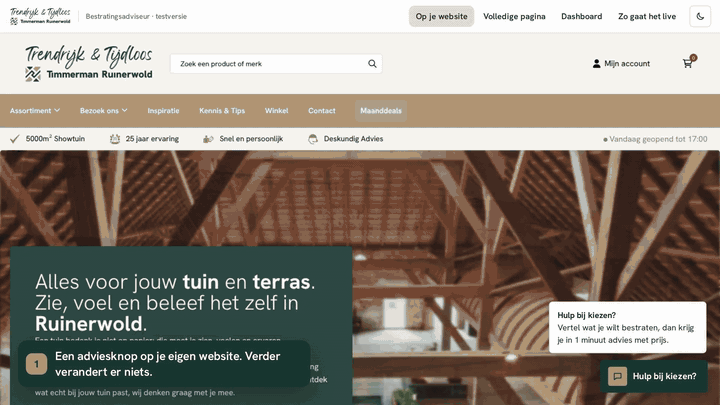
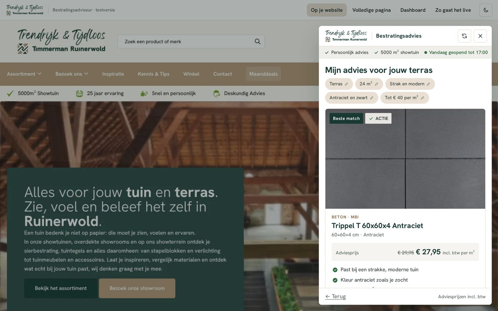
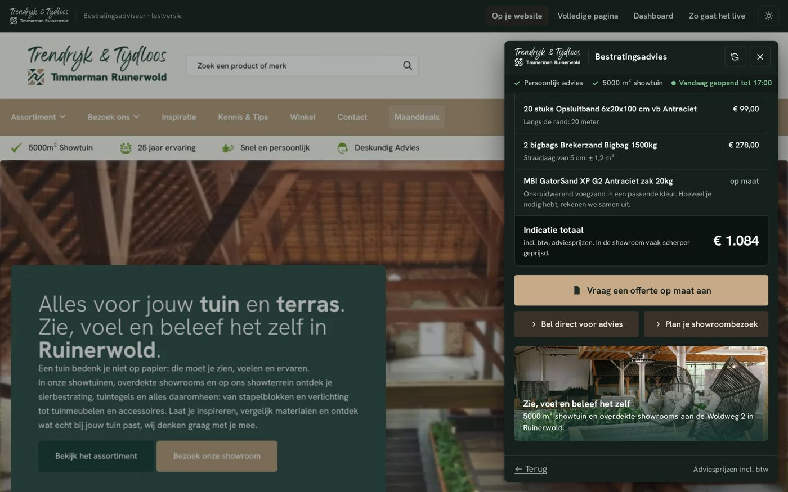
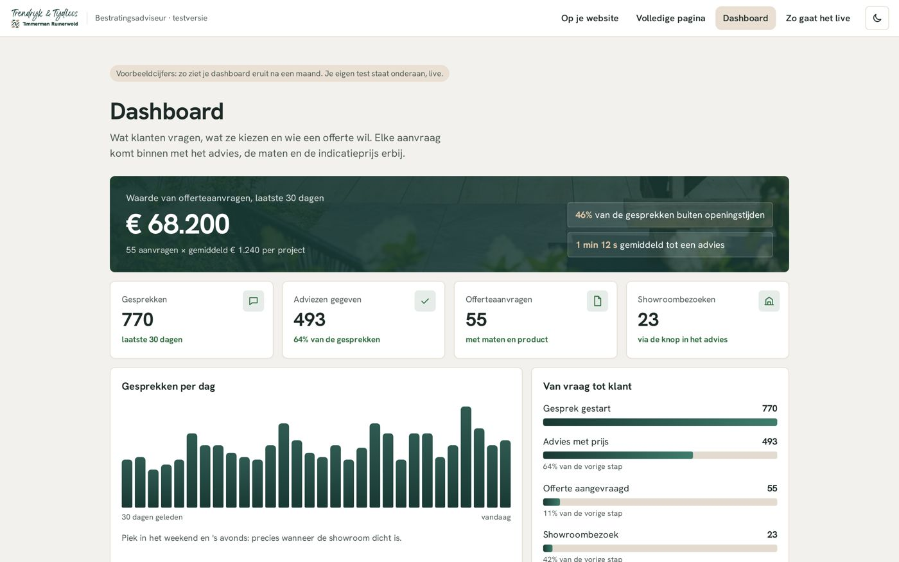
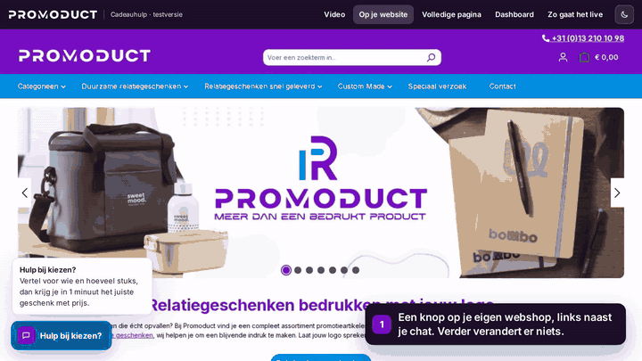
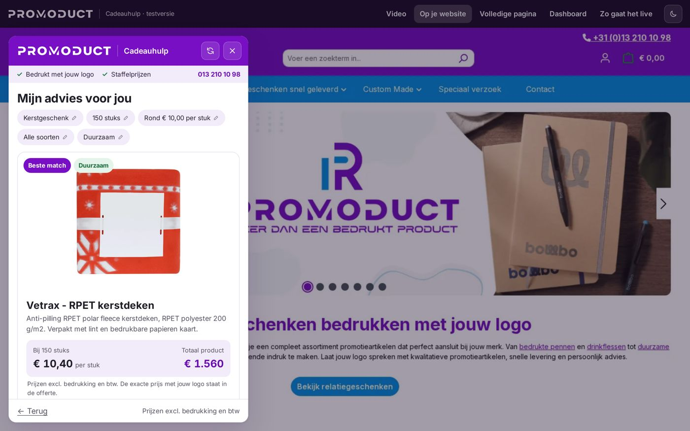
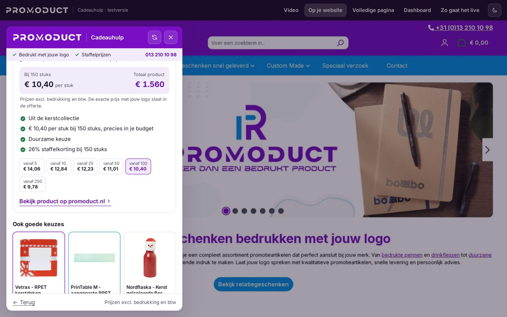
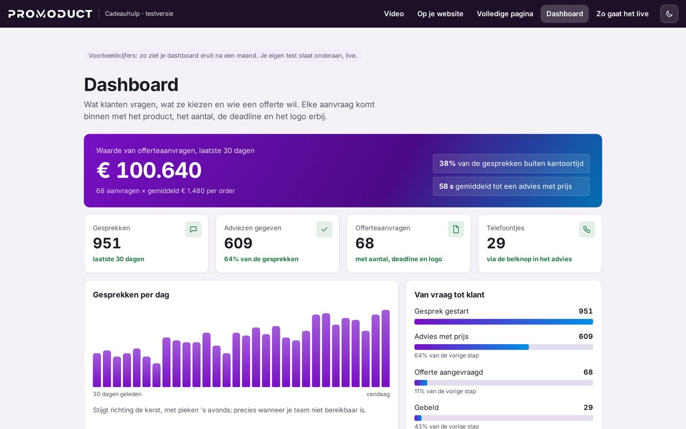
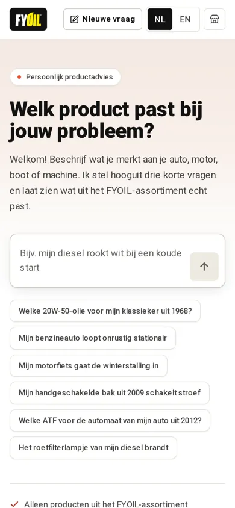

<div align="center">

# 🛍️ AI Product Advisors for Webshops

**Customers describe what they need in their own words and get the right products from the shop's real catalogue, with quantities, prices and a quote or checkout. No invented products.**




</div>

## The problem every webshop has

In a store, staff ask two or three questions and point to the right product. Online, customers face hundreds of similar items, don't know what fits, and leave. Generic chatbots make it worse: they invent products the shop doesn't sell.

**These advisors only recommend products that exist in the shop's catalogue,** explain why each one fits, and turn the visit into an order or a complete quote request. They are added to an existing shop with one line of code.

---

## 1. Paving advisor with a full materials calculation
*A Dutch paving and garden-materials company with a 5,000 m² showroom*

A customer types *"terrace of 6 by 4 metres, modern, anthracite"* and instantly gets 3 matching tiles from the real range, plus everything else the job needs.

- **108 real products** with the company's own prices, offers, stock and photos
- **Complete calculation per choice:** tiles including cutting waste, edging, bedding sand and joint filler
- **Quote request** with sizes and product, plus call and showroom-visit buttons
- **Owner dashboard:** what customers ask, which products they pick, who wants a quote
- Locked to the company's own domain, light and dark, phone and desktop

<p align="center">
  
  
  
</p>

▶️ **[Watch the 55-second walkthrough](media/paving-walkthrough.mp4)**

---

## 2. Business-gift advisor
*A Dutch corporate-gifts webshop*



A buyer types *"150 Christmas gifts for staff, around €25, sustainable"* and gets matching gifts from **240 products**, with tiered prices for that quantity and a quote button.

- Matches on occasion, budget per person, quantity and style (luxury, sustainable, practical)
- Budget-aware scoring, so suggestions land *near* the target price, not just under it
- Product photos fetched automatically with a GitHub Actions pipeline

<p align="center">
  
  
  
</p>

▶️ **[Watch the 55-second walkthrough](media/gifts-walkthrough.mp4)** · The owner's first reaction: *"the first setup looks genuinely great"*

---

## 3. Oil and wellness product advisor
*A Dutch oil webshop, 41 products, Dutch and English*

<p align="center"> </p>

- Asks short follow-up questions, then shows 2–3 products with the reason for each and a link to buy
- Refuses to recommend anything that isn't in the catalogue
- **100% correct on a 45-question test set, run 3 times;** first answer in about 0.4 seconds
- A report of questions it couldn't answer, showing the shop what customers look for and don't find

🔗 **[Try it live](https://fyoil-product-advisor.vercel.app/)**

---

## How it works

```text
Shop catalogue (feed / export / scrape)  ──►  normalised product data (price, stock, specs, photos)
                                                   │
Customer question ──► intent + constraints ──► scoring & filtering on REAL products only
                                                   │
                         answer with reasons + quantities + price ──► order / quote / callback
                                                   │
                                   owner dashboard: questions, choices, leads, gaps
```

**Stack:** Next.js · React · TypeScript · LLM APIs · embeddable widget · CSP frame-ancestors lock · Vercel

**Keywords:** AI product advisor, AI shopping assistant, product recommendation engine, ecommerce chatbot, Shopify AI, WooCommerce AI, Lightspeed, keuzehulp, product finder, guided selling, LLM, RAG, Next.js

---

<div align="center">

### Want something like this for your business?

**[Sadaqat Rasool](https://sadaqatrasool.vercel.app)**, Full-Stack & AI Software Engineer (Next.js · React · Node.js · Python · LLMs)

[Portfolio](https://sadaqatrasool.vercel.app) · [LinkedIn](https://www.linkedin.com/in/sadaqatrasool/) · [Email](mailto:sadaqatrasoolmsr@gmail.com) · Open to remote roles and client projects

<sub>This is a showcase repository. The source code belongs to client projects and stays private; this page shows what was built and how.</sub>

</div>
